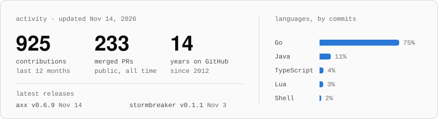

<picture>
  <source media="(prefers-color-scheme: dark)" srcset="assets/hero-dark.svg">
  
</picture>

I'm a cofounder of [NimbusXR](https://nimbusxr.us), where we build AI and extended reality software for commercial and federal customers. Most of my time goes to one question: how do you know software works when an agent wrote it?

### Building

<table>
  <tr>
    <td width="50%" valign="top">
      <a href="https://github.com/nimbusxr/axx"><b>axx</b></a> Go  
      Acceptance testing for the agentic era. Verifies running software against executable acceptance criteria, black-box, whatever language, architecture, or agent built it. <a href="https://github.com/nimbusxr/axx-evals">axx-evals</a> measures how well coding agents write those tests.  
      <a href="https://axx.nimbusxr.us">axx.nimbusxr.us</a>
    </td>
    <td width="50%" valign="top">
      <a href="https://github.com/nimbusxr/stormbreaker"><b>stormbreaker</b></a> Go  
      Smoke and load tests for shared environments, built on axx, where every team is answerable for the data its systems create. Break it on purpose. Leave nothing behind.  
      <a href="https://stormbreaker.nimbusxr.us">stormbreaker.nimbusxr.us</a>
    </td>
  </tr>
</table>

### Upstream

[kafbat/kafka-ui](https://github.com/kafbat/kafka-ui), the open-source web UI for Apache Kafka: [OAuth2 proxy support](https://github.com/kafbat/kafka-ui/pull/1540), [connector-level permissions for Kafka Connect](https://github.com/kafbat/kafka-ui/pull/1541), and [publishing through Schema Registry with any subject strategy](https://github.com/kafbat/kafka-ui/pull/1650).

 

<picture>
  <source media="(prefers-color-scheme: dark)" srcset="https://raw.githubusercontent.com/joshuaNathaniel/joshuaNathaniel/output/stats-dark.svg">
  
</picture>

<a href="https://www.linkedin.com/in/joshuanathaniel/">LinkedIn</a> · <a href="https://nimbusxr.us">nimbusxr.us</a>

